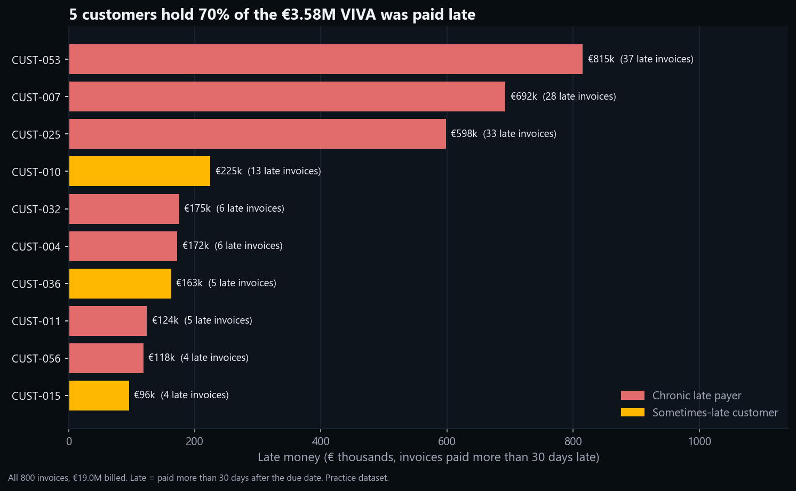
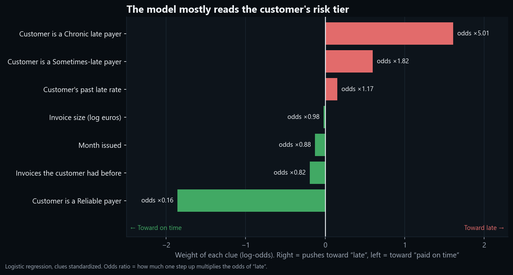

# Call the Right Customers First
## How a free model tells a collections team who to phone, and why a simple rule gets you almost as far

> **About the data.** VIVA's invoices in this study are a realistic practice dataset (800 invoices, 59 active customers, about €19M, December 2009 to November 2011), not real ledger data. Its shape comes from a real public payment dataset, and its severity is calibrated to Latin America using the Coface 2025 payment survey. Treat the percentages as a demonstration of the method, not as a measurement of any real company.

### The Problem in plain numbers

Latin American companies wait longer to be paid than almost anyone. Coface's 2025 survey puts average payment terms at **59 days**, reports that **77% of firms** see late payments, and puts the average delay at **42 days**. Late money is cash you cannot spend, and chasing it costs staff time.

In VIVA's invoices, **166 of 800 invoices (20.8%) were paid more than 30 days late.** That is **€3.58M, or 19% of everything billed**, and the average late invoice arrived **62 days** after its due date. Twenty-two invoices were more than 90 days late.

The late money is not spread evenly. Five customers account for **70%** of it:

| Customer | Late invoices | Late money |
|---|---:|---:|
| CUST-053 | 37 of 54 | €815,032 |
| CUST-007 | 28 of 38 | €692,361 |
| CUST-025 | 33 of 53 | €598,291 |
| CUST-010 | 13 of 40 | €224,880 |
| CUST-032 | 6 of 6 | €175,336 |

This is the same mismatch we saw in Month 1: the accounts that matter for your cash are not the ones that bill the most. They are the ones with a habit of paying late.

---

### Three Findings That Change How You Think About Collections

Before building any model, we looked at *why* invoices end up late. The results dismantled a few common assumptions.

**1. Lateness is a customer habit, not an invoice feature.**

Big invoices are not paid later than small ones. The late rate was 23% for the smallest quarter of invoices and 18% for the largest quarter, and the link between invoice size and days late was essentially zero (correlation -0.02). The month the invoice was issued did not give a stable pattern either. What predicts a late payment is *who* the customer is.

- Reliable customers (33 of them): **0 late invoices out of 476**
- Sometimes-late customers (14): **24% late**
- Chronic late payers (12): **69% late**

**2. A dozen customers cause four fifths of the problem.**

The 12 chronic late payers produce **81%** of all late money. Only 23 of the 59 customers were ever late. The reliable customers, who make up **€11.3M of the €19M** billed, never were. Calling everyone equally treats a customer who has never been late the same as one who is late seven times out of ten.

**3. When a customer is late, they are very late.**

Late invoices were not a few days over the line. Half arrived 57 days or more past due, and the worst reached 154 days. A call after day 30 is already behind. A call *before* the due date, aimed at the right customer, is worth far more.

Predictable problems are solvable problems.

> [!IMPORTANT]
> *Governance note #1: Who decides who gets called?* When the choice of whom to chase is informal ("whoever I remember"), nobody can audit it, improve it, or explain why one customer got a call and another did not. A scoring model, or even a written rule, makes the prioritization visible and repeatable.

---

### Why We Did Not Trust the Headline Accuracy Score

We built our main model, a **logistic regression**, and compared it with three other approaches and a "do nothing" baseline. The 800 invoices were split **at random**: 640 to learn from and **160** to test on. The models never saw the test invoices. The split is *stratified*, which means both groups keep the same share of late invoices (20.8% in training, 20.6% in test). 33 of the 160 test invoices were late. The first thing you see on the scoreboard is accuracy:

| Approach | Accuracy | Late invoices caught | Alarms that were right |
|---|---:|---:|---:|
| **Do nothing** (assume everyone pays on time) | 79.4% | **0 of 33** | n/a |
| **Logistic Regression** | 81.9% | **27 of 33** | 54.0% |
| Random Forest | 85.6% | 23 of 33 | 63.9% |
| Gradient Boosting* | 84.4% | 21 of 33 | 61.8% |
| Decision Tree | 83.8% | 21 of 33 | 60.0% |

*Stand-in for XGBoost, which was not installed in this environment.

Accuracy flatters here. Because most invoices are paid on time, a "model" that never raises an alarm is already right 79% of the time, and it catches nothing. The real value is in the third column: how many late invoices the model found before they became late.

We chose **Logistic Regression**. It has the lowest accuracy of the four models, but it **catches the most late invoices (27 of 33)**, and a missed late payer costs more than a wasted phone call. Its reasoning can be written on one page, and you can explain it to a credit manager. The price is more false alarms (23, against 13 for Random Forest). **A model you can explain is a model you can use.**

**How the logistic regression was set up.** Three settings matter most:

- **Stratified random split** (`train_test_split` with `test_size=0.2`, `stratify`, `random_state=2995`). Random and stratified, so the test group has the same late rate as the training group, and the fixed seed means anyone who reruns it gets the same split.
- **Balanced class weights** (`class_weight="balanced"`). Only about 1 in 5 invoices is late, so each late invoice counts 2.4 times more during training. Without it the model catches 23 of 33 late invoices (70%) instead of 27 (82%), with 14 false alarms instead of 23. The F1 score barely moves (0.66 vs 0.65), so this is a choice, not a free win.
- **Standard scaling and default regularization** (`StandardScaler`, L2 penalty, `C=1`). The clues are put on one scale so their weights can be compared, and the penalty stops the model from leaning too hard on any one clue.

**What the model "thinks".** Logistic regression gives every clue a weight. The biggest by far is the customer's risk tier: a **chronic late payer multiplies the odds of "late" by 5.0**, a **reliable customer cuts them to 0.16**, and a sometimes-late customer raises them by 1.8. The customer's past late rate adds a small push (1.17), while invoice size and month barely matter.

We also tested whether a more flexible setting helps. It does not. Across a 1,000,000-fold range of the regularization strength `C`, the score on new invoices stayed between **81% and 83%**, and the gap between train and test never exceeded 7 points. With only seven clues, logistic regression cannot memorize the past the way a deep decision tree can. The simple default is enough.

> **A caution on the model itself:** Almost everything the model "knows" comes from the customer's risk tier. It flagged **all 37 invoices from chronic late payers, 13 of 30 from sometimes-late customers, and none of 93 from reliable customers.** A plain rule, "call the chronic payers first", would have done most of the same job. The model's blind spot is the middle group: **sometimes-late customers had 10 late invoices in the test, and the model caught only 4 of them.**

> **A caution on the test.** The split is random, so the model sometimes learns from invoices newer than the ones it is tested on. When we instead trained on the oldest 80% and tested on the newest 20%, the model caught every late invoice (24 of 24) but was right on only 40% of its alarms. Treat the random-split scores as a best case.

---

### The Numbers That Matter

**Test group: 160 invoices, a random 20% of the full December 2009 to November 2011 period (about €3.8M billed)**

| | Call everyone | With the model | Difference |
|---|---:|---:|---:|
| Calls to make | 160 | 50 | **-69%** |
| Late invoices reached | 33 of 33 | 27 of 33 | 82% |
| Late money flagged | €561k | €351k | 63% of late money |

What the 50 calls looked like:

| Outcome | Invoices | Money |
|---|---:|---:|
| ✅ Late and flagged in time | 27 | €351k |
| ❌ Late but missed | 6 | €210k |
| ❌ False alarm (customer would have paid) | 23 | €688k |

In plain terms: the team makes about a third of the calls and reaches more than four fifths of the late invoices, but only about two thirds of the late money, because the missed invoices are larger on average. The price is 23 wasted calls and €210k of late money that slips through.

**What we are not claiming.** This is not a savings number. We have not measured how much faster customers pay *after* a call, so we cannot say how many euros the model recovers. The €3.58M of late money over 24 months (about €1.8M a year) is the size of the problem, not the size of the prize. Measure the effect of calls in a pilot before putting a euro figure on it.

---

### Can You Build This Yourself?

Yes. This matters more than the model selection.

**The technology stack: free.**
The whole analysis runs in Python (pandas, scikit-learn) on a normal laptop, with the results shown as charts in this report. No licenses, no cloud fees, no vendor contracts. The run is repeatable: a fixed random seed means anyone who reruns it gets exactly the same numbers.

**The model: transparent.**
Logistic Regression adds up a handful of clues, such as the customer's past late rate, their risk tier and the invoice size. Each clue has a weight you can read, and for every invoice you can see which clues pushed it toward "late". That is the opposite of a black box.

**The AI sidekick: optional but powerful.**
You do not need to code this from scratch. Bring your invoice export and your business context to an AI assistant and ask it to walk you through the steps. But challenge it. Ask why. Question its assumptions. Your knowledge of which customers are fragile is the reason the output is useful.

> ⚠️ **One critical prerequisite:** Data quality comes first. If payment dates are missing, credit notes are not matched to invoices, or one customer appears under three names, fix that before you build anything. A model that scores well on bad data is still a bad model.

---

### Monday Morning Decision Rule

**This week:** Export the last 12 months of invoices. For each customer, count how many of their invoices were paid more than 30 days late, and rank customers by the **euros** they paid late. If five customers account for more than half of your late money, you do not have a general collections problem. You have a **handful-of-customers problem**.

Then, before the next invoice to those customers falls due, pick up the phone. Start with the top five. Once a month, add anyone whose last four invoices were late more than twice, since that is exactly the group the model missed.

> [!IMPORTANT]
> *Governance note #2: Practice data, open-source tools, and who owns the decision.*
> This study used a **practice dataset**. Before relying on any figure here, rerun the method on your own invoices and check the results against what your collections team already knows.
> Every tool used (Python, pandas, scikit-learn) is open-source, so the code can be read and audited. The analysis runs locally, with no calls to outside servers and no customer data leaving the machine.
> Open-source removes vendor risk. It does not remove the governance requirement. Someone in the organization must understand what the model does, check periodically whether it still works, and own the decision to act on it. A model flags risk. People decide whom to call and how.

---

**Sources:** Coface, *2025 Latin America Corporate Payment Survey*; "Payment Date Dataset" (Kaggle, rajattomar132), used for data shape only.

[← Back to Series README](../README.md)
