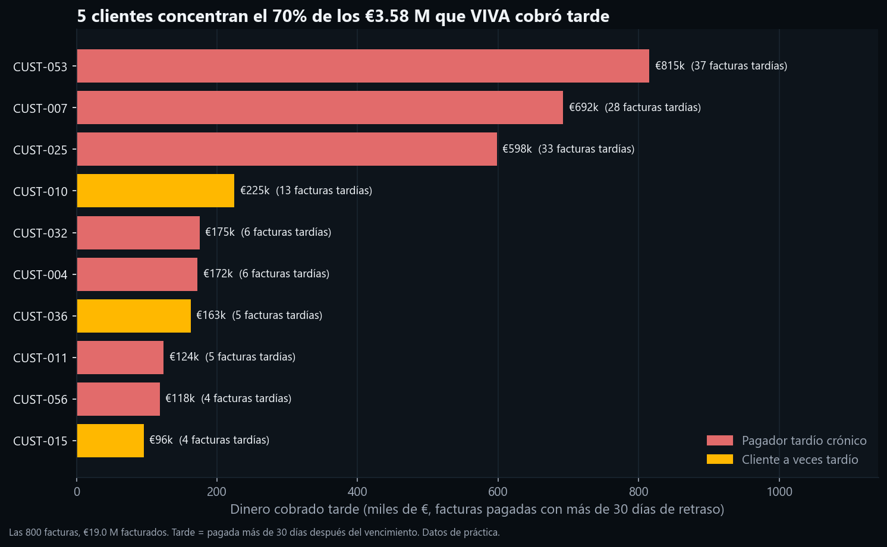
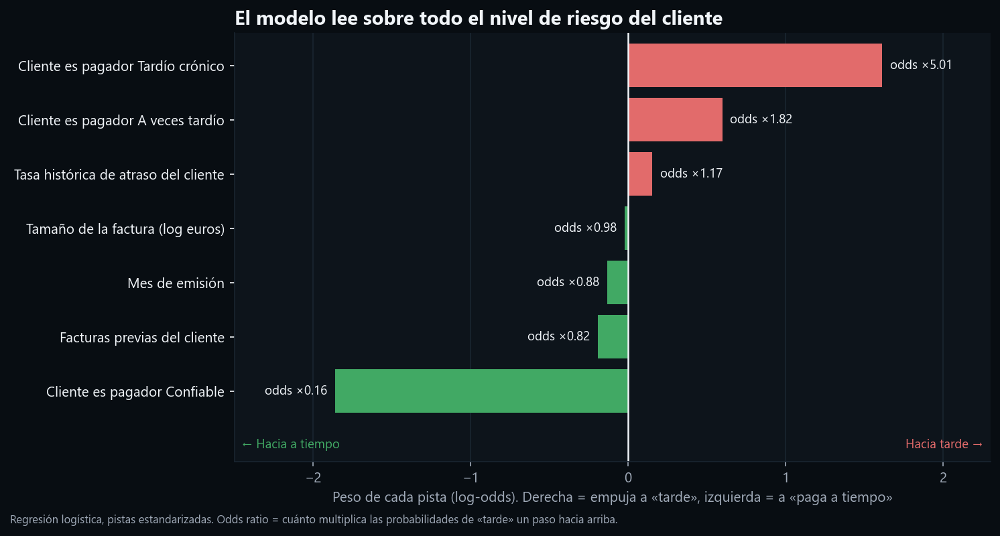

# Llame primero a los clientes correctos
## Cómo un modelo gratuito le dice a un equipo de cobranza a quién llamar, y por qué una regla simple llega casi igual de lejos

> **Sobre los datos.** Las facturas de VIVA en este estudio son un conjunto de datos de práctica realista (800 facturas, 59 clientes activos, unos €19M, de diciembre de 2009 a noviembre de 2011), no datos contables reales. Su forma proviene de un conjunto público de datos de pagos real, y su severidad está calibrada a América Latina con la encuesta de pagos de Coface 2025. Tome los porcentajes como una demostración del método, no como una medición de ninguna empresa real.

### El problema en números simples

Las empresas latinoamericanas esperan más para cobrar que casi cualquier otra región. La encuesta de Coface 2025 sitúa el plazo medio de pago en **59 días**, indica que el **77% de las empresas** sufre pagos tardíos y estima el retraso medio en **42 días**. El dinero cobrado tarde es efectivo que no puede gastar, y perseguirlo cuesta horas de trabajo del equipo.

En las facturas de VIVA, **166 de 800 facturas (20.8%) se pagaron con más de 30 días de retraso.** Eso son **€3.58M, o el 19% de todo lo facturado**, y la factura tardía promedio llegó **62 días** después de su vencimiento. Veintidós facturas llevaron más de 90 días de retraso.

El dinero tardío no está repartido de forma pareja. Cinco clientes concentran el **70%**:

| Cliente | Facturas tardías | Dinero tardío |
|---|---:|---:|
| CUST-053 | 37 de 54 | €815,032 |
| CUST-007 | 28 de 38 | €692,361 |
| CUST-025 | 33 de 53 | €598,291 |
| CUST-010 | 13 de 40 | €224,880 |
| CUST-032 | 6 de 6 | €175,336 |

Es el mismo desajuste que vimos en el Mes 1: las cuentas que importan para su caja no son las que más facturan. Son las que tienen el hábito de pagar tarde.

---

### Tres hallazgos que cambian cómo piensa la cobranza

Antes de construir cualquier modelo, miramos *por qué* las facturas terminan tardías. Los resultados desmontaron algunas suposiciones comunes.

**1. La tardanza es un hábito del cliente, no una característica de la factura.**

Las facturas grandes no se pagan más tarde que las pequeñas. La tasa de atraso fue del 23% en el cuarto más pequeño de las facturas y del 18% en el cuarto más grande, y la relación entre el tamaño de la factura y los días de atraso fue prácticamente nula (correlación -0.02). El mes de emisión tampoco mostró un patrón estable. Lo que predice un pago tardío es *quién* es el cliente.

- Clientes confiables (33): **0 facturas tardías de 476**
- Clientes a veces tardíos (14): **24% tardías**
- Pagadores tardíos crónicos (12): **69% tardías**

**2. Una docena de clientes causa cuatro quintos del problema.**

Los 12 pagadores tardíos crónicos generan el **81%** de todo el dinero tardío. Solo 23 de los 59 clientes pagaron tarde alguna vez. Los clientes confiables, que suman **€11.3M de los €19M** facturados, nunca lo hicieron. Llamar a todos por igual trata a un cliente que nunca se ha atrasado igual que a uno que se atrasa siete de cada diez veces.

**3. Cuando un cliente se atrasa, se atrasa mucho.**

Las facturas tardías no pasaron la línea por unos pocos días. La mitad llegó con 57 días o más de retraso, y la peor alcanzó 154 días. Una llamada después del día 30 ya llega tarde. Una llamada *antes* del vencimiento, dirigida al cliente correcto, vale mucho más.

Los problemas predecibles son problemas solucionables.

> [!IMPORTANT]
> *Nota de gobierno #1: ¿Quién decide a quién se llama?* Cuando la elección de a quién perseguir es informal («a quien me acuerde»), nadie puede auditarla, mejorarla ni explicar por qué un cliente recibió una llamada y otro no. Un modelo de puntuación, o incluso una regla escrita, vuelve la priorización visible y repetible.

---

### Por qué no confiamos en la exactitud como cifra principal

Construimos nuestro modelo principal, una **regresión logística**, y lo comparamos con otros tres enfoques y una línea base de «no hacer nada». Las 800 facturas se dividieron **al azar**: 640 para aprender y **160** para probar. Los modelos nunca vieron las facturas de prueba. La división es *estratificada*, es decir, ambos grupos mantienen la misma proporción de facturas tardías (20.8% en entrenamiento, 20.6% en prueba). 33 de las 160 facturas de prueba fueron tardías. Lo primero que se ve en el marcador es la exactitud:

| Enfoque | Exactitud | Facturas tardías detectadas | Alarmas acertadas |
|---|---:|---:|---:|
| **No hacer nada** (suponer que todos pagan a tiempo) | 79.4% | **0 de 33** | n/a |
| **Regresión logística** | 81.9% | **27 de 33** | 54.0% |
| Random Forest | 85.6% | 23 de 33 | 63.9% |
| Gradient Boosting* | 84.4% | 21 de 33 | 61.8% |
| Árbol de decisión | 83.8% | 21 de 33 | 60.0% |

*Sustituto de XGBoost, que no estaba instalado en este entorno.

La exactitud engaña aquí. Como la mayoría de las facturas se paga a tiempo, un «modelo» que nunca da una alarma ya acierta el 79% de las veces, y no detecta nada. El valor real está en la tercera columna: cuántas facturas tardías encontró el modelo antes de que se atrasaran.

Elegimos la **regresión logística**. Tiene la exactitud más baja de los cuatro modelos, pero **detecta más facturas tardías (27 de 33)**, y una factura tardía que se escapa cuesta más que una llamada innecesaria. Su razonamiento cabe en una página y se puede explicar a un gerente de crédito. El costo son más falsas alarmas (23, frente a 13 de Random Forest). **Un modelo que puede explicar es un modelo que puede usar.**

**Cómo se configuró la regresión logística.** Tres ajustes importan más:

- **División aleatoria estratificada** (`train_test_split` con `test_size=0.2`, `stratify`, `random_state=2995`). Es aleatoria y estratificada, así que el grupo de prueba tiene la misma tasa de atraso que el de entrenamiento, y la semilla fija hace que quien repita el análisis obtenga la misma división.
- **Pesos de clase balanceados** (`class_weight="balanced"`). Solo cerca de 1 de cada 5 facturas es tardía, por lo que cada factura tardía pesa 2.4 veces más durante el entrenamiento. Sin esto, el modelo detecta 23 de 33 facturas tardías (70%) en lugar de 27 (82%), con 14 falsas alarmas en lugar de 23. El puntaje F1 casi no cambia (0.66 frente a 0.65), así que es una decisión, no una ganancia gratuita.
- **Escalado estándar y regularización por defecto** (`StandardScaler`, penalización L2, `C=1`). Las pistas se ponen en una misma escala para poder comparar sus pesos, y la penalización evita que el modelo se apoye demasiado en una sola pista.

**Lo que «piensa» el modelo.** La regresión logística da un peso a cada pista. El mayor, con diferencia, es el nivel de riesgo del cliente: un **pagador tardío crónico multiplica por 5.0 las probabilidades de «tarde»**, un **cliente confiable las reduce a 0.16**, y un cliente a veces tardío las multiplica por 1.8. La tasa histórica de atraso del cliente añade un empuje pequeño (1.17), mientras que el tamaño de la factura y el mes casi no importan.

También probamos si un ajuste más flexible ayuda. No ayuda. En un rango de un millón de veces de la fuerza de regularización `C`, la exactitud sobre facturas nuevas se mantuvo entre **81% y 83%**, y la brecha entre entrenamiento y prueba nunca superó los 7 puntos. Con solo siete pistas, la regresión logística no puede memorizar el pasado como lo haría un árbol de decisión profundo. El valor por defecto basta.

> **Una advertencia sobre el modelo:** Casi todo lo que el modelo «sabe» viene del nivel de riesgo del cliente. Marcó **las 37 facturas de pagadores tardíos crónicos, 13 de 30 de clientes a veces tardíos y ninguna de 93 de clientes confiables.** Una regla simple, «llame primero a los pagadores crónicos», habría hecho buena parte del mismo trabajo. El punto ciego del modelo es el grupo intermedio: **los clientes a veces tardíos tuvieron 10 facturas tardías en la prueba, y el modelo detectó solo 4.**

> **Una advertencia sobre la prueba.** La división es aleatoria, así que el modelo a veces aprende de facturas más nuevas que las que luego se usan para probarlo. Cuando en cambio entrenamos con el 80% más antiguo y probamos con el 20% más reciente, el modelo detectó todas las facturas tardías (24 de 24), pero acertó solo el 40% de sus alarmas. Tome los resultados de la división aleatoria como el mejor caso.

---

### Los números que importan

**Grupo de prueba: 160 facturas, un 20% aleatorio de todo el período de diciembre de 2009 a noviembre de 2011 (unos €3.8M facturados)**

| | Llamar a todos | Con el modelo | Diferencia |
|---|---:|---:|---:|
| Llamadas a hacer | 160 | 50 | **-69%** |
| Facturas tardías alcanzadas | 33 de 33 | 27 de 33 | 82% |
| Dinero tardío señalado | €561k | €351k | 63% del dinero tardío |

Cómo se vieron las 50 llamadas:

| Resultado | Facturas | Dinero |
|---|---:|---:|
| ✅ Tardía y señalada a tiempo | 27 | €351k |
| ❌ Tardía pero no detectada | 6 | €210k |
| ❌ Falsa alarma (el cliente habría pagado) | 23 | €688k |

En términos simples: el equipo hace cerca de un tercio de las llamadas y alcanza más de cuatro quintos de las facturas tardías, pero solo cerca de dos tercios del dinero tardío, porque las facturas no detectadas son más grandes en promedio. El precio son 23 llamadas inútiles y €210k de dinero tardío que se escapa.

**Lo que no afirmamos.** Esto no es una cifra de ahorro. No hemos medido cuánto más rápido pagan los clientes *después* de una llamada, así que no podemos decir cuántos euros recupera el modelo. Los €3.58M de dinero tardío en 24 meses (unos €1.8M al año) son el tamaño del problema, no el tamaño del premio. Mida el efecto de las llamadas en un piloto antes de poner una cifra en euros.

---

### ¿Puede construir esto usted mismo?

Sí. Esto importa más que la elección del modelo.

**La tecnología: gratuita.**
Todo el análisis corre en Python (pandas, scikit-learn) en un portátil normal, con los resultados en gráficos dentro de este informe. Sin licencias, sin costos de nube, sin contratos con proveedores. La ejecución es repetible: una semilla aleatoria fija significa que cualquiera que la repita obtiene exactamente los mismos números.

**El modelo: transparente.**
La regresión logística suma un puñado de pistas, como la tasa histórica de atraso del cliente, su nivel de riesgo y el tamaño de la factura. Cada pista tiene un peso que se puede leer, y para cada factura se ve qué pistas la empujaron hacia «tarde». Es lo contrario de una caja negra.

**El asistente de IA: opcional pero potente.**
No necesita programar esto desde cero. Lleve su exportación de facturas y su contexto de negocio a un asistente de IA y pídale que le guíe paso a paso. Pero cuestiónelo. Pregunte por qué. Ponga a prueba sus supuestos. Su conocimiento de qué clientes son frágiles es la razón por la que el resultado es útil.

> ⚠️ **Un requisito crítico:** primero, la calidad de los datos. Si faltan fechas de pago, las notas de crédito no están emparejadas con sus facturas o un mismo cliente aparece con tres nombres, corríjalo antes de construir nada. Un modelo que puntúa bien con datos malos sigue siendo un mal modelo.

---

### Regla de decisión para el lunes por la mañana

**Esta semana:** Exporte las facturas de los últimos 12 meses. Para cada cliente, cuente cuántas de sus facturas se pagaron con más de 30 días de retraso, y ordene a los clientes por los **euros** que pagaron tarde. Si cinco clientes concentran más de la mitad de su dinero tardío, usted no tiene un problema general de cobranza. Tiene un **problema de unos pocos clientes**.

Luego, antes de que venza la próxima factura de esos clientes, levante el teléfono. Empiece por los cinco primeros. Una vez al mes, añada a quien haya pagado tarde más de dos de sus últimas cuatro facturas, pues es exactamente el grupo que el modelo no detectó.

> [!IMPORTANT]
> *Nota de gobierno #2: Datos de práctica, herramientas de código abierto y quién es dueño de la decisión.*
> Este estudio usó un **conjunto de datos de práctica**. Antes de apoyarse en cualquier cifra de aquí, repita el método con sus propias facturas y compare los resultados con lo que su equipo de cobranza ya sabe.
> Todas las herramientas usadas (Python, pandas, scikit-learn) son de código abierto, por lo que el código puede leerse y auditarse. El análisis corre de forma local, sin llamadas a servidores externos y sin que salgan datos de clientes de la máquina.
> El código abierto elimina el riesgo de proveedor. No elimina el requisito de gobierno. Alguien en la organización debe entender qué hace el modelo, comprobar periódicamente si sigue funcionando y ser dueño de la decisión de actuar con él. Un modelo señala el riesgo. Las personas deciden a quién llamar y cómo.

---

**Fuentes:** Coface, *2025 Latin America Corporate Payment Survey*; "Payment Date Dataset" (Kaggle, rajattomar132), usado solo para la forma de los datos.

[← Volver al README de la serie](../README.md)
